<div align="center">

<picture>
  <source media="(prefers-color-scheme: dark)" srcset=".github/assets/banner-dark.svg">
  
</picture>

**Native vector graphics and render-thread animations for PAM Native.**<br>
Icons, progress rings, gradients and dashed strokes parsed once, retained natively and animated without crossing back to PHP.

[](https://packagist.org/packages/pushinbr/pam-native-svg)
[](https://github.com/push-in/pam-native-svg/releases/latest)

[](LICENSE)

[Install](#install) · [Quick example](#quick-example) · [Platforms](#platform-support) · [Features](#features) · [Docs](#docs) · [Issues](https://github.com/push-in/pam-native-svg/issues)

</div>

<a id="install"></a>
## <picture></picture> Install

Inside a PAM Native project, add only this capability:

```sh
pam composer require pushinbr/pam-native-svg
pam doctor --fix
```

New to PAM? Create a project with `pam init my-app --template native` (see the [PAM Native overview](https://push-in.github.io/pam-docs/native/overview/)), then come back here. Composer owns the manifest and the lockfile; `pam composer` runs it on PAM's verified PHP runtime.

<a id="quick-example"></a>
## <picture></picture> Quick example

```php
<?php

declare(strict_types=1);

use Pam\Native\Svg\{Svg, Path, ProgressRing, SvgAnimation, SvgProperty};

ProgressRing::make($upload->fraction)->size(44)->strokeWidth(3)->color('#ffffff');

Svg::fromFile(__DIR__.'/assets/send.svg')->tint('#1d9bf0')->size(24);

Svg::make(24, 24)
    ->add(Path::make('M5 12l5 5L19 7')->id('check')->fill('none')->stroke('#fff', 2)->pathLength(1)->trim(0, 0))
    ->animate(SvgAnimation::to('check', SvgProperty::TrimEnd, $done ? 1 : 0)->duration(260));
```

Declarative `.pam` components use the same native view:

```html
<SvgIcon src="assets/icons/send.svg" tint="#1d9bf0" size="24" />
<ProgressRing :progress="$fraction" size="44" stroke="3" color="#fff" />
```

PHP builds or loads the markup; the native side parses each content hash once into a retained tree (Android Canvas + RenderNode, iOS CAShapeLayer) and runs animations itself, so a progress ring updating 30 times a second never re-renders PHP or re-parses a path. A complete screen is in [examples/UploadProgress.php](examples/UploadProgress.php).

<a id="platform-support"></a>
## <picture></picture> Platform support

| Platform | Support | Notes |
| --- | --- | --- |
| Android | API 26+ | Canvas / RenderNode; Choreographer animations only while visible |
| iOS | 15.0+ | Core Animation (`CAShapeLayer`, `CABasicAnimation`); see [iOS validation](docs/ios-validation.md) |
| PAM Native | 1.0.0 to < 2.0.0 | From `pam-native.plugin.json` (composer.json requires ^1.0.15); PHP 8.5+ |

<a id="requirements"></a>
## <picture></picture> Requirements

No permissions and no dependencies beyond the platform SDKs (iOS frameworks: CoreGraphics, QuartzCore, UIKit). The plugin registers one host view, `svg.view`.

<a id="features"></a>
## <picture></picture> Features

- `Svg`, `Path` (all commands incl. arcs), `Circle`, `Ellipse`, `Rect`, `Line`, `Polyline`,
  `Polygon`, `G`, `ClipPath`, `LinearGradient`, `RadialGradient`, transforms, opacity,
  dash arrays/offsets with `pathLength`, `trim()`.
- `Svg::fromString()` / `Svg::fromFile()` with hash-keyed caches on both sides; `tint()`,
  `color()` (currentColor), `size()`, `fit()`.
- Native animations of opacity, dash offset, trim, rotation, scale, translation and stroke
  width; continuous retargeting; repeat/reverse/delay; `onAnimationEnd`.
- Bounded memory: 128-entry/4 MiB PHP source LRU, 64-document/2 MiB native LRU trimmed on memory
  pressure; no frames while a view is hidden or detached.

| | |
| --- | --- |
| **Best for** | Icons, progress rings, badges, gradients, decorative vectors |
| **Native path** | Android Canvas / RenderNode · Core Animation |
| **Animation** | Choreographer (only while visible) · CABasicAnimation |
| **Dependencies** | None beyond the platform SDKs |

See [docs/svg.md](docs/svg.md) for the full API, supported markup and the comparison with `react-native-svg`.

<a id="testing"></a>
## <picture></picture> Testing

```bash
pam tests/run.php                                  # PHP contracts
cd android && gradle -PpamPluginApi=/path/pam-native-android-plugin-api-1.39.2.aar \
  testDebugUnitTest connectedDebugAndroidTest      # JVM + emulator instrumentation
```

iOS: follow [docs/ios-validation.md](docs/ios-validation.md) on a Mac.

<a id="docs"></a>
## <picture></picture> Docs

- [PAM Native overview](https://push-in.github.io/pam-docs/native/overview/)
- [Plugin and native capability model](https://push-in.github.io/pam-docs/native/plugins/)
- [PAM introduction](https://push-in.github.io/pam-docs/introduction/)
- [Changelog](CHANGELOG.md)
- [Report an issue](https://github.com/push-in/pam-native-svg/issues)
- [Full API, supported markup and react-native-svg comparison](docs/svg.md)
- [iOS validation](docs/ios-validation.md)
- [Example: upload progress](examples/UploadProgress.php)

<a id="pam-ecosystem"></a>
## <picture></picture> Part of the PAM ecosystem

<p align="center"><picture>
  <source media="(prefers-color-scheme: dark)" srcset=".github/assets/pam-wordmark-dark.svg">
  
</picture></p>

PAM runs PHP natively on servers, desktops and phones. This repository is one piece of it.

| [**PAM**](https://github.com/push-in/pam) | [**PAM Desktop**](https://github.com/push-in/pam-desktop) | [**PAM Native**](https://github.com/push-in/pam-native) | [**Ecosystem**](https://github.com/push-in/pam#ecosystem) |
| --- | --- | --- | --- |
| the runtime and CLI | native desktop apps in PHP | native Android and iOS apps in PHP | every official package and plugin |

<sub>Docs: [push-in.github.io/pam-docs](https://push-in.github.io/pam-docs/introduction/) · [Issues](https://github.com/push-in/pam-native-svg/issues)</sub>

<p align="center"><sub><a href="LICENSE">Apache License 2.0</a> · Made in Brazil by Pushin</sub></p>
